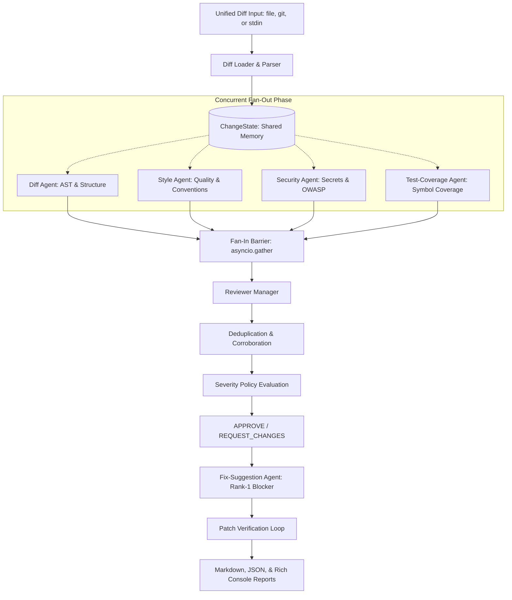

# Automated Code Review Board

A high-performance, production-grade multi-agent code review system that analyzes unified diffs, runs concurrent specialist agents, calculates corroboration-adjusted risk scores, issues deterministic merge recommendations (`APPROVE` vs `REQUEST_CHANGES`), and generates verified in-memory remediation patches.

Built with **Semantic Kernel (Python SDK)**.

---

## Architecture Overview

The system executes a concurrent **Fan-Out / Fan-In** pipeline centered on an asynchronous shared memory object (`ChangeState`):



### Specialist Agents
- **Diff Agent (`agents/diff_agent.py`)**: Computes structural diff statistics, detects risk areas (auth, crypto, payments, database, subprocess), extracts modified AST symbols, and assigns size classifications (`XS` to `XL`).
- **Style Agent (`agents/style_agent.py`)**: Enforces Python and JavaScript formatting rules on added lines only (naming conventions, line length, docstrings, cyclomatic complexity, debug prints, bare excepts, wildcard imports). Grounded in the style knowledge base.
- **Security Agent (`agents/security_agent.py`)**: Detects high-entropy credentials, cloud provider tokens (AWS, GitHub, Slack), and unsafe patterns (SQL injection, command injection via `shell=True`, XSS, insecure deserialization, deprecated crypto). Secrets are strictly masked everywhere.
- **Test-Coverage Agent (`agents/test_coverage_agent.py`)**: Extracts new public functions and classes, scans the test corpus for references and assertions, maps per-symbol test adequacy, and calculates change test ratios.
- **Reviewer Manager (`agents/reviewer_manager.py`)**: Merges duplicate findings using token Jaccard similarity, detects multi-agent corroboration, calculates severity-weighted merge risk scores, and outputs the final recommendation.
- **Fix-Suggestion Agent (`agents/fix_suggestion_agent.py`)**: Novelty feature. Produces an automated unified-diff fix for the rank-1 finding and executes an in-memory **Patch Verification Loop** ("Fix-and-Re-Review") before presenting the fix.

---

## Key Features

1. **Deterministic Offline Mode & Model-Augmented LLM Mode:**
   - **Offline (Default):** Runs fully locally without API keys or network access, completing full reviews in under 100 milliseconds.
   - **LLM Mode:** Uses Semantic Kernel agents with structured JSON schema validation to augment findings when credentials are provided.
2. **Patch Verification Loop:**
   - Validates that the suggested fix applies cleanly in memory.
   - Verifies AST syntax validity.
   - Re-runs security and style analyzers to ensure the original vulnerability is eliminated and zero new issues are introduced.
   - Marks verdict as `VERIFIED`, `PARTIAL`, or `REJECTED`.
3. **Cross-Agent Corroboration:**
   - When independent agents flag overlapping regions of risk (e.g. Security flags an f-string query and Test-Coverage flags the missing test), the issue receives a corroboration badge and score multiplier.
4. **Grounded Retrieval:**
   - Findings attach citations to canonical documentation chunks in `knowledge_base/` via TF-IDF search.

---

## Installation

### Prerequisites
- Python 3.11 or Python 3.12
- Git

### Setup
```bash
# Clone repository
git clone <repository-url>
cd "agentic ai 2"

# Create and activate virtual environment
python3 -m venv .venv
source .venv/bin/activate

# Install dependencies
pip install -r requirements.txt
```

---

## Quick Start

### 1. Run the Multi-Sample Demo
Evaluate all 5 representative diffs in offline mode:

```bash
python -m cli.main demo
# or via Makefile:
make demo
```

### 2. Review a Diff File
Review an individual unified diff file:

```bash
python -m cli.main review --diff samples/diffs/02_sql_injection_and_secret.diff
```

### 3. Review a Git Commit Range
Review uncommitted or branch changes in a git repository:

```bash
python -m cli.main review --git "HEAD~1..HEAD"
```

### 4. Review via Piped Standard Input
```bash
git diff main..feature | python -m cli.main review --stdin
```

### 5. CI / Automated Gating
Block pull request merges by enforcing non-zero exit code on `REQUEST_CHANGES`:

```bash
python -m cli.main review --diff pr.diff --fail-on-request-changes
```

---

## Sample Review Output Excerpt

When evaluating `samples/diffs/02_sql_injection_and_secret.diff`:

```
╭──────────────────────────── Merge Recommendation ────────────────────────────╮
│ ❌ REQUEST CHANGES  [Merge-Risk Score: 100/100]                              │
│                                                                              │
│ Why this decision:                                                           │
│ Merge changes requested due to 2 blocking issue(s) exceeding risk tolerance  │
│ (Merge Risk Score: 100/100). Critical blockers: Rank #1 [CRITICAL]: Hard-    │
│ Coded AWS Access Key Detected; Rank #2 [CRITICAL]: SQL Injection in user     │
│ query. Remediation must be applied before merging.                           │
╰──────────────────────────────────────────────────────────────────────────────╯

╭────────────────── Suggested Fix for Top Finding - VERIFIED ──────────────────╮
│ --- a/src/db/user_repository.py                                              │
│ +++ b/src/db/user_repository.py                                              │
│ @@ -8,1 +8,1 @@                                                              │
│ -    aws_key = "AKIAIOSFODNN7EXAMPLE12"                                      │
│ +    aws_key = os.environ.get("AWS_KEY")                                     │
│                                                                              │
╰─────────────────────────── Verified In-Memory ───────────────────────────────╯
```

Output artifacts are generated in `output/<change_id>/`:
- `review.md`: Human-readable GitHub-flavored markdown report.
- `review.json`: Complete machine-readable data snapshot.

---

## Configuration Reference

Settings can be specified in `config/severity_policy.yaml` or overridden via environment variables prefixed with `CRB_`:

| Environment Variable | Default | Description |
| :--- | :--- | :--- |
| `CRB_MODE` | `offline` | Execution mode: `offline` or `llm` |
| `CRB_LOG_LEVEL` | `INFO` | Logging verbosity (`DEBUG`, `INFO`, `WARNING`, `ERROR`) |
| `CRB_AGENT_TIMEOUT_SECONDS` | `60.0` | Per-agent timeout limit in seconds |
| `CRB_SIMULATE_FAILURE` | `None` | Agent name to simulate fault injection (`security`, `style`, etc.) |
| `CRB_LLM_PROVIDER` | `openai` | Model provider: `openai` or `azure_openai` |
| `CRB_LLM_MODEL_ID` | `gpt-4o` | Model deployment identifier |
| `CRB_LLM_API_KEY` | `None` | API key for model service |
| `CRB_LLM_ENDPOINT` | `None` | Optional endpoint URL (e.g. for Azure OpenAI) |
| `CRB_SEVERITY_POLICY_PATH` | `config/severity_policy.yaml` | Path to severity policy configuration |
| `CRB_ENTROPY_THRESHOLD` | `4.3` | Shannon entropy cutoff for high-entropy secret detection |
| `CRB_MAX_LINE_LENGTH` | `100` | Maximum allowed line length for style check |

---

## Adding a New Agent

The architecture is fully modular. To add a new domain agent:
1. Create a plugin under `plugins/` with analysis logic.
2. Create an agent under `agents/` extending `BaseAgent`.
3. Register the agent in `core/orchestrator.py` inside `ReviewOrchestrator.__init__` and `specialists` list.
4. The manager will automatically include the new agent in concurrent execution, deduplication, corroboration, and ranking.

---

## Limitations

- **Syntactic Scope:** In offline mode, semantic style and naming checks rely on Python AST analysis; compiled languages (C++, Go, Rust) use regex-based pattern matching.
- **In-Memory Patch Scope:** Automated fix synthesis targets the single highest-severity finding (rank-1); multi-finding sequential patches are intentionally excluded to prevent cumulative patch conflicts.
- **External Network Access:** Offline mode deliberately disables network calls; package vulnerability lookups check local knowledge base rules rather than live CVE registries.
