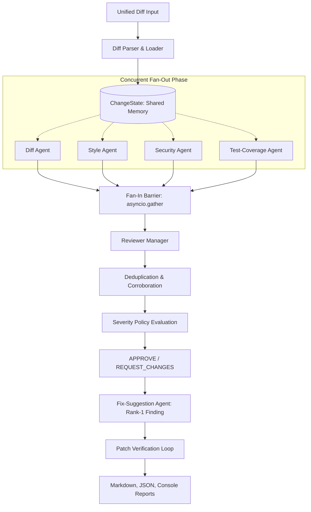
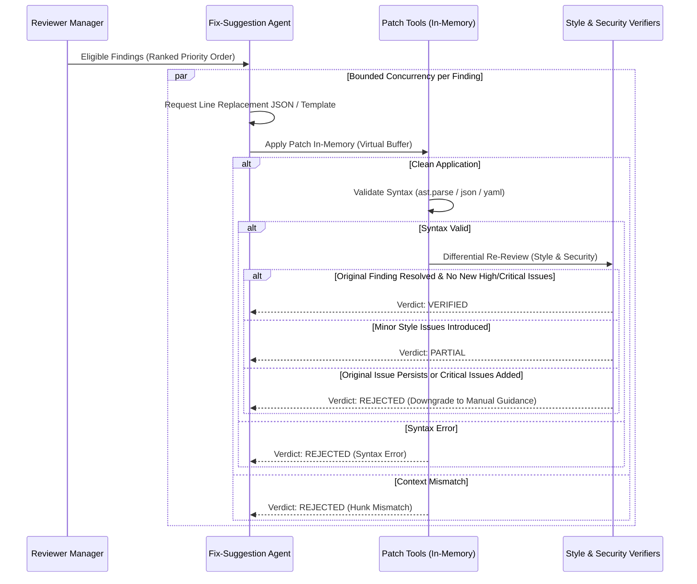

# System Architecture: Automated Code Review Board

This document describes the design, concurrency model, framework integrations, and reliability guarantees of the Automated Code Review Board.

---

## 1. Overview and Coordination Architecture

The system employs a **Concurrent Fan-Out / Fan-In Multi-Agent Architecture** orchestrated around a shared memory object (`ChangeState`).



---

## 2. Framework Components & Semantic Kernel Integration

The agent runtime is built on **Semantic Kernel (Python SDK)**:

1. **`Kernel`**: Centrally configured dependency container providing plugin registry and execution context.
2. **`KernelPlugin`**: Encapsulates domain logic into callable functions:
   - `DiffPlugin`: Structural metrics, AST symbol extraction, risk area tagging.
   - `StylePlugin`: Added-line AST linting, cyclomatic complexity, docstrings, conventions.
   - `SecurityPlugin`: OWASP vulnerability detection, entropy analysis, secret scanning.
   - `CoveragePlugin`: Added symbol extraction, test corpus scanning, test ratio calculation.
   - `RetrievalPlugin`: TF-IDF grounded citations from `knowledge_base/`.
3. **`ChatCompletionAgent`**: Framework agent wrapping model interactions with role instructions and prompt templates.
4. **`OfflineStubChatCompletion`**: Framework-compliant `ChatCompletionClientBase` implementation providing deterministic offline execution without requiring external API access.

---

## 3. Shared State Model (`ChangeState`)

All agents operate on a unified shared memory structure (`core.state.ChangeState`):

- **Immutable Input**: `raw_diff`, `files` (parsed `FileChange` structures), `change_id`, `source`.
- **Per-Agent Slots**: Agents write results strictly to their dedicated slot (`state.agent_results[self.name]`).
- **Concurrency Control**: Asynchronous operations that modify global state (summary, timeline, review) acquire `asyncio.Lock`.
- **Audit Timeline**: Every lifecycle transition (`started`, `completed`, `failed`) is captured in `state.timeline` with sub-millisecond precision.

---

## 4. Concurrency & Performance

1. **True Asynchronous Fan-Out**:
   Specialist agents execute concurrently using `asyncio.gather`. Total wall-clock runtime corresponds to `max(agent_times)` rather than `sum(agent_times)`.
2. **Sub-Second Offline Processing**:
   In offline mode, a 1,000-line diff evaluates across all 4 agents in under 100ms.
3. **Token Optimization**:
   - Diffs provided to LLM prompts are capped at 4,000 characters to prevent context window exhaustion.
   - Grounded retrieval uses lightweight TF-IDF indexing over vector embeddings, eliminating external API latency and costs.

---

## 5. Fault Isolation & Graceful Degradation

Review pipelines must never crash due to an individual agent's failure:

- **Per-Agent Timeouts**: Controlled via `asyncio.wait_for` using configurable thresholds (`CRB_AGENT_TIMEOUT_SECONDS`).
- **Error Isolation**: Each `BaseAgent.run()` wraps its execution in comprehensive exception handlers. If an agent raises an unhandled exception or times out, it posts an `AgentResult(status="failed"|"timeout")` with diagnostic notes.
- **Degraded Synthesis**: The Reviewer Manager evaluates available findings regardless of whether one or more specialist agents failed.
- **Simulated Fault Injection**: The `--simulate-failure <agent>` configuration flag enables deterministic testing of degradation paths.

---

## 6. Novelty: Patch Verification Loop ("Fix-and-Re-Review")

Rather than emitting unverified code suggestions, the system validates proposed fixes before presentation.

### Stage 3 Gating (`should_suggest_fixes`)
Stage 3 execution is gated through `should_suggest_fixes(settings)`:
- `CRB_FIX_SUGGESTIONS=never`: The fix stage is completely bypassed; `state.suggested_patch` and `state.fix_suggestions` remain empty.
- `CRB_FIX_SUGGESTIONS=auto` *(default)*: Active only when `settings.llm_enabled` is True (`mode="llm"` with an API key). In offline mode, analysis runs without fix suggestions.
- `CRB_FIX_SUGGESTIONS=always`: Generates the rule-based template patch for the rank-1 finding even in offline mode.

### LLM Fix Generation Flow
In LLM mode with an API key:
1. **Candidate Selection**: Takes non-DIFF, non-INFO findings from `priority_order` up to `CRB_FIX_MAX_FINDINGS`.
2. **Concurrent Bounded Invocations**: Issues one call per finding using `asyncio.Semaphore(fix_llm_concurrency)`.
3. **Structured Prompting**: Includes rule ID, severity, recommendation, redacted code snippet, relevant added lines with real line numbers, and grounded knowledge base recipes. Prompts model for strict JSON (`replace`, `new_file`, or `manual`).
4. **Validation & In-Memory Verification**:
   - For `replace`: verifies line numbers are added lines in the diff, applies patch to virtual buffer, validates AST syntax, and executes differential re-review with count-based resolution.
   - For `new_file`: checks syntax of new file against `/dev/null` (e.g. test files), marked `syntax-checked only`.
   - On rejection or syntax error: diff is cleared and recorded as manual guidance.



    RM->>FSA: Highest-Severity Finding (Rank #1)
    FSA->>FSA: Generate Unified Diff Template Patch
    FSA->>PT: Apply Patch In-Memory (Virtual Buffer)
    alt Clean Application
        PT->>PT: Validate Syntax (ast.parse / json / yaml)
        alt Syntax Valid
            PT->>Verif: Differential Re-Review (Style & Security)
            alt Original Finding Resolved & No New High/Critical Issues
                Verif-->>FSA: Verdict: VERIFIED
            else Minor Style Issues Introduced
                Verif-->>FSA: Verdict: PARTIAL
            else Original Issue Persists or Critical Issues Added
                Verif-->>FSA: Verdict: REJECTED
            end
        else Syntax Error
            PT-->>FSA: Verdict: REJECTED (Syntax Error)
        end
    else Context Mismatch
        PT-->>FSA: Verdict: REJECTED (Hunk Mismatch)
    end
```

---

## 7. Cross-Agent Corroboration Scoring

When distinct agents independently detect overlapping regions of risk:
1. `identify_corroborations()` groups findings matching the same file and line overlap window (±3 lines).
2. The finding records all participating agents in `finding.corroborated_by`.
3. The merge risk score scales by `(1 + 0.10 * corroboration_count)`.
4. Corroborated findings receive priority ranking boosts and prominent visual indicators in reports.
