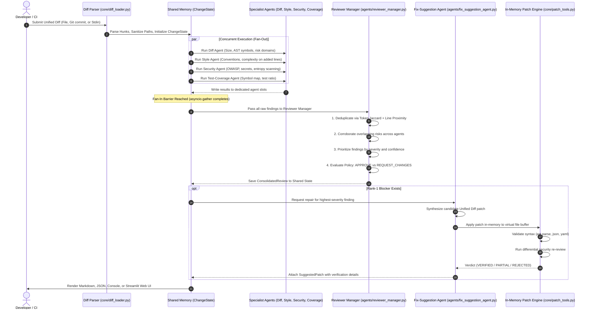

# Automated Code Review Board: Complete System Architecture & Operational Guide

This document is a comprehensive, end-to-end guide to the **Automated Code Review Board**. It explains the core purpose of the project, how every component functions under the hood, the complete data flow, a function-by-function breakdown of the codebase, and a detailed walkthrough of the Web User Interface.

---

## Table of Contents
1. [Project Overview & Core Philosophy](#1-project-overview--core-philosophy)
2. [End-to-End System Flow](#2-end-to-end-system-flow)
3. [The Multi-Agent Roster: Who Does What](#3-the-multi-agent-roster-who-does-what)
4. [The Novelty: Patch Verification Loop](#4-the-novelty-patch-verification-loop)
5. [Cross-Agent Corroboration & Risk Scoring](#5-cross-agent-corroboration--risk-scoring)
6. [Function-by-Function Codebase Walkthrough](#6-function-by-function-codebase-walkthrough)
   - [6.1 Core System & State (`core/`)](#61-core-system--state-core)
   - [6.2 Specialist Agents (`agents/`)](#62-specialist-agents-agents)
   - [6.3 Domain Plugins (`plugins/`)](#63-domain-plugins-plugins)
   - [6.4 Reporting Engine (`reporting/`)](#64-reporting-engine-reporting)
   - [6.5 Command Line Interface (`cli/`)](#65-command-line-interface-cli)
   - [6.6 Web User Interface (`ui/`)](#66-web-user-interface-ui)
7. [Complete Web UI Walkthrough](#7-complete-web-ui-walkthrough)
   - [7.1 Sidebar Controls & Inputs](#71-sidebar-controls--inputs)
   - [7.2 Layman / Plain English Perspective](#72-layman--plain-english-perspective)
   - [7.3 Technical Developer Perspective](#73-technical-developer-perspective)
   - [7.4 What Every Badge & Metric Means](#74-what-every-badge--metric-means)
8. [How to Run, Test, and Demonstrate](#8-how-to-run-test-and-demonstrate)

---

## 1. Project Overview & Core Philosophy

### The Problem
In modern software development, peer code reviews and pull requests are critical for quality control. However:
- **Reviewer Fatigue:** Human engineers miss hard-coded passwords, dangerous shell injection vulnerabilities, and subtle edge cases when reviewing large code updates.
- **Siloed Static Linters:** Traditional static analysis tools produce noisy lists of hundreds of disconnected warnings without understanding overall business risk or whether new features have tests.
- **Unverified Suggestions:** Many automated assistants suggest code fixes that are syntactically broken, introduce new security bugs, or fail to apply cleanly.

### The Solution
The **Automated Code Review Board** implements a concurrent team of specialist agents built on **Semantic Kernel (Python SDK)**. It ingests a code diff, fans it out to four specialist agents simultaneously, deduplicates and corroborates their findings, calculates an enterprise risk score, issues an authoritative `APPROVE` or `REQUEST_CHANGES` verdict, and **proves** its suggested repair in an in-memory virtual test sandbox before showing it to you.

---

## 2. End-to-End System Flow

The system operates on an asynchronous **Concurrent Fan-Out / Fan-In** pattern:



---

## 3. The Multi-Agent Roster: Who Does What

| Agent | Module | Role & Responsibility | What It Looks For |
| :--- | :--- | :--- | :--- |
| **🔍 Diff Agent** | `agents/diff_agent.py` | Change Structural Analyst | Calculates lines added/deleted, classifies size (`XS` to `XL`), extracts declared functions/classes using Python AST, and tags sensitive domains (`auth`, `crypto`, `database`, `payments`, `subprocess`). |
| **🎨 Style Agent** | `agents/style_agent.py` | Quality & Maintainability Guardian | Evaluates **added lines only**. Checks line lengths, naming standards (`snake_case`, `PascalCase`), missing docstrings, cyclomatic complexity, debug prints (`print`, `console.log`), bare `except:` clauses, and wildcard imports. |
| **🛡️ Security Agent** | `agents/security_agent.py` | Vulnerability & Secrets Inspector | Scans for hard-coded credentials (AWS keys, GitHub tokens, Slack secrets), high-entropy strings, SQL injection, command injection (`shell=True`), XSS (`innerHTML`), and weak cryptography. **Strictly redacts all secrets.** |
| **🧪 Test-Coverage Agent** | `agents/test_coverage_agent.py` | Test Adequacy Detective | Maps all newly introduced public symbols to test files. Checks for assertions and error-path tests. Calculates the change test ratio and flags untested business logic as `HIGH` severity. |
| **⚖️ Reviewer Manager** | `agents/reviewer_manager.py` | Chief Synthesizer & Arbiter | Eliminates duplicate warnings, rewards corroborated findings, calculates the cumulative merge-risk score, and issues the official `APPROVE` or `REQUEST_CHANGES` verdict. |
| **🔧 Fix-Suggestion Agent** | `agents/fix_suggestion_agent.py` | Automated Repair Specialist | Synthesizes a unified diff patch for the #1 worst blocker and runs the **Patch Verification Loop** in an in-memory virtual sandbox before presenting it. |

---

## 4. The Novelty: Patch Verification Loop

Unlike conventional tools that suggest untested code snippets, this platform runs a closed-loop **"Fix-and-Re-Review"** cycle:

1. **In-Memory Application:** The suggested patch is applied to a virtual copy of the affected file entirely in memory using fuzzy hunk matching. The user's real disk files are **never modified**.
2. **Syntax Validation:** The virtual file is parsed using language-specific syntax checkers (`ast.parse` for Python; JSON and YAML parsers for configuration files).
3. **Differential Re-Review:** The Security and Style rule engines are re-run on the patched content. The engine verifies:
   - Does the original vulnerability disappear?
   - Did the patch introduce any new syntax or security issues?
4. **Verdicts:**
   - 🟢 **`VERIFIED`**: Applies cleanly, syntax is 100% valid, original flaw is eliminated, and zero new issues introduced.
   - 🟡 **`PARTIAL`**: Applies cleanly and fixes the core flaw, but minor cosmetic notices (like line length) were introduced.
   - 🔴 **`REJECTED`**: Context mismatch, syntax error, or secondary regression detected. The system honestly marks it rejected and provides manual remediation guidance instead.

---

## 5. Cross-Agent Corroboration & Risk Scoring

### What is Multi-Agent Corroboration?
When independent specialist agents flag the same file and overlapping line window (for example, the **Security Agent** flags an f-string SQL query and the **Test-Coverage Agent** flags that the enclosing function has zero tests), the system realizes this is an especially dangerous issue.

### The Math:
1. **Base Severity Weights:**
   - `CRITICAL`: 40 points
   - `HIGH`: 20 points
   - `MEDIUM`: 8 points
   - `LOW`: 2 points
   - `INFO`: 0 points
   $$\text{Base Score} = \min\left(100, \sum \text{Weight}(f)\right)$$
2. **Corroboration Multiplier:**
   For every corroborated finding, the score receives a 10% uplift:
   $$\text{Final Risk Score} = \min\left(100, \text{round}\left(\text{Base Score} \times (1 + 0.10 \times N_{\text{corroborated}})\right)\right)$$
3. **Merge Acceptance Rules:**
   - If any `CRITICAL` or `HIGH` finding exists $\rightarrow$ `REQUEST_CHANGES`
   - If $\text{Final Risk Score} \ge 30$ $\rightarrow$ `REQUEST_CHANGES`
   - Otherwise $\rightarrow$ `APPROVE`

---

## 6. Function-by-Function Codebase Walkthrough

### 6.1 Core System & State (`core/`)

#### `core/models.py`
- `Severity(str, Enum)`: Defines `CRITICAL`, `HIGH`, `MEDIUM`, `LOW`, `INFO` with comparative operators (`__lt__`, `__ge__`).
- `Finding(BaseModel)`: Represents an issue with deterministic ID, title, description, file location, redacted snippet, canonical `rule_id`, confidence, citations, and corroborating agents.
- `FileChange(BaseModel)`: Metadata for each modified file (lines added/removed, language, role, hunks).
- `ChangeSummary(BaseModel)`: Aggregate changeset summary computed by the Diff Agent.
- `SuggestedPatch(BaseModel)`: Proposed unified diff with follow-up instructions and `PatchVerification` outcome.
- `ConsolidatedReview(BaseModel)`: The final review output containing the merge decision, risk score, findings grouped by severity, and priority order.

#### `core/state.py`
- `ChangeState(BaseModel)`: The central shared memory object.
- `record_agent_start(agent_name)`: Records start event and timestamp under an `asyncio.Lock`.
- `record_agent_result(result)`: Stores the agent's findings, duration, and status.
- `set_summary(summary)`: Saves the diff summary and registers detected risk areas.
- `set_consolidated_review(review)`: Stores the final decision from the Reviewer Manager.

#### `core/diff_loader.py`
- `parse_diff_text(raw_diff, max_lines=5000)`: Uses `unidiff` to parse diff text, sanitizes file paths to prevent directory traversal (`../../`), and safely truncates massive diffs with a warning.
- `normalize_diff_hunk_headers(diff_text)`: Auto-corrects malformed `@@ -X,Y +X,Y @@` headers by recounting actual diff lines.
- `detect_language(file_path)`: Maps extensions (`.py`, `.js`, `.yaml`, etc.) to language names.
- `detect_file_role(file_path)`: Categorizes files into `source`, `test`, `config`, `docs`, `dependency`, or `build`.
- `load_diff_from_file(path)` / `load_diff_from_stdin(text)` / `load_diff_from_git(range)`: Convenience loaders that produce initialized `ChangeState` objects.

#### `core/orchestrator.py`
- `ReviewOrchestrator`: Master workflow engine.
- `run_review(state)`: Orchestrates the pipeline:
  1. Concurrently launches `diff_agent`, `style_agent`, `security_agent`, and `test_coverage_agent` via `asyncio.gather`.
  2. Hits the fan-in barrier and invokes `reviewer_manager`.
  3. If blockers exist, invokes `fix_suggestion_agent` to patch rank #1.

#### `core/dedup.py`
- `calculate_token_jaccard(text1, text2)`: Computes normalized word overlap between finding titles and descriptions.
- `are_findings_duplicate(f1, f2)`: Returns `True` if two findings share the same file, overlapping lines, and either the same `rule_id` or Jaccard similarity $\ge 0.60$.
- `merge_findings(findings)`: Deduplicates findings, preserving the highest severity, unioning reporters, and consolidating recommendations.

#### `core/ranking.py`
- `identify_corroborations(findings)`: Finds independent agent reports on the same code region and tags `corroborated_by`.
- `calculate_merge_risk_score(findings, policy)`: Implements the weighted score formula and corroboration multiplier.
- `rank_findings(findings, policy)`: Sorts findings in descending risk order (Severity rank, corroboration bonus, confidence, category priority).
- `evaluate_merge_decision(findings, policy)`: Applies decision rules to determine `APPROVE` or `REQUEST_CHANGES`.

#### `core/patch_tools.py`
- `apply_unified_diff_in_memory(original_text, patch_text)`: Applies unified diff hunks in reverse line order to virtual buffers using fuzzy window matching.
- `check_syntax(content, language)`: Validates syntax using `ast.parse` for Python, `json.loads` for JSON, and `yaml.safe_load` for YAML.
- `verify_patch(target_path, original_text, patch_text, finding)`: Re-runs security and style analyzers to guarantee the flaw is resolved without regressions.

#### `core/retrieval.py`
- `KnowledgeBase`: Loads all Markdown files in `knowledge_base/`, splits them by headings, and builds an in-memory TF-IDF index.
- `search(query, top_k=3, category_filter)`: Cosine similarity search returning matching documentation chunks.
- `lookup_rule(rule_id)`: Direct $O(1)$ index lookup for canonical rule documentation.

#### `core/logging_setup.py`
- `redact_secrets_in_text(text)`: Regex filter masking AWS keys, GitHub tokens, Slack webhooks, and passwords.
- `SafeFormatter`: Custom logging formatter that applies secret redaction and prepends `[change_id]`.

---

### 6.2 Specialist Agents (`agents/`)

- `agents/base_agent.py` (`BaseAgent`): Abstract base class. Provides `asyncio.wait_for` timeout protection, error isolation (catches unhandled exceptions and marks agent `failed` without crashing the pipeline), and simulated fault injection support (`--simulate-failure`).
- `agents/diff_agent.py` (`DiffAgent`): Computes changeset statistics, extracts symbols, and populates `state.summary`.
- `agents/style_agent.py` (`StyleAgent`): Analyzes added lines against clean code rules, docstrings, and cyclomatic complexity.
- `agents/security_agent.py` (`SecurityAgent`): Scans for credentials, injection vulnerabilities, and weak APIs.
- `agents/test_coverage_agent.py` (`TestCoverageAgent`): Maps symbols to test files and validates assertion quality.
- `agents/reviewer_manager.py` (`ReviewerManager`): Fan-in aggregator that dedups, corroborates, ranks, and decides.
- `agents/fix_suggestion_agent.py` (`FixSuggestionAgent`): Generates and verifies safe remediation patches for the top finding.

---

### 6.3 Domain Plugins (`plugins/`)

- `plugins/diff_plugin.py`: AST symbol extractors and size classification logic.
- `plugins/style_plugin.py`: 15+ AST visitors and regex patterns for style, naming, and complexity.
- `plugins/security_plugin.py`: Shannon entropy calculation, cloud token patterns, and OWASP heuristics.
- `plugins/coverage_plugin.py`: Symbol test mapper, assertion detector, and XML/JSON coverage report parser.
- `plugins/retrieval_plugin.py`: Semantic Kernel plugin exposing `search_knowledge_base` and `lookup_rule_citation`.

---

### 6.4 Reporting Engine (`reporting/`)

- `reporting/markdown_report.py`: Produces `review.md` matching the exact 9-section order required by §10 of the project spec.
- `reporting/json_report.py`: Serializes the entire `ChangeState` and `ConsolidatedReview` snapshot into formatted `review.json`.
- `reporting/console_report.py`: Renders terminal output using `rich` tables, panels, and severity badges.

---

### 6.5 Command Line Interface (`cli/`)

- `cli/main.py`: Typer CLI application.
  - `review`: Runs review on `--diff <path>`, `--git <range>`, or `--stdin`. Supports `--mode [offline|llm]`, `--fail-on-request-changes` (returns exit code 1 for CI gating), and `--simulate-failure <agent>`.
  - `demo`: Evaluates all 5 sample diffs in offline mode and prints an executive summary comparison table.

---

### 6.6 Web User Interface (`ui/`)

- `ui/app.py`: Streamlit web application supporting both **Layman / Plain English View** and **Technical Developer View**.

---

## 7. Complete Web UI Walkthrough

The web interface is hosted locally at **`http://localhost:8501`**.

```
┌─────────────────────────────────────────────────────────────────────────────┐
│ 🛡️ Automated Code Review Board                                              │
│ Your AI-Powered Quality & Security Gatekeeper                               │
├─────────────────────────────────────────────────────────────────────────────┤
│ 🛑 DO NOT MERGE YET (Changes Requested)                                     │
│ Hold on! The board found 2 serious blockers that could break your           │
│ application, leak private credentials, or invite hackers.                   │
├──────────────────┬──────────────────┬──────────────────┬────────────────────┤
│ Overall Risk     │ Must-Fix Blockers│ Total Notices    │ Turnaround Time    │
│ 100 / 100        │ 2 Urgent Items   │ 7 Notices        │ 6.8 ms             │
│ 🔴 Dangerous     │ 2 Critical       │ 2 Crit • 2 High  │ ⚡ Lightning Fast  │
└──────────────────┴──────────────────┴──────────────────┴────────────────────┘
```

### 7.1 Sidebar Controls & Inputs

1. **Display Perspective Radio:**
   - **`👶 Layman / Plain English View`**: Designed for non-technical stakeholders, managers, or students. Hides raw diff code by default and explains everything in clear business terms.
   - **`👨‍💻 Technical Developer View`**: The original engineering layout. Displays raw diffs, exact rule IDs (`SEC-SQLI-001`), line citations, confidence ratings, and python code snippets.
2. **Agent Brain Mode:**
   - `offline`: Runs deterministic rule engines in <0.1 seconds without API keys.
   - `llm`: Uses Semantic Kernel models for generative reasoning.
3. **Diff Input Source:**
   - **Pre-Made Real Examples:** Pre-loaded real-world scenarios:
     - 🟢 *Clean & Safe Feature* (What good code looks like)
     - 🚨 *Leaked Password & Database Flaw* (Critical security emergency)
     - ⚠️ *Feature Built with Zero Tests* (Accident waiting to happen)
     - 🧹 *Messy & Hard-to-Read Code* (High technical debt)
     - 📦 *Complex Multi-File PR* (Real-world mix of bugs and security risks)
   - **Upload a Diff File:** Upload `.diff`, `.patch`, or `.txt` files directly from your computer.
   - **Paste Unified Diff:** A text box to paste git diff output.
4. **"🚀 Run Team Review Now" Button:** Triggers the multi-agent pipeline.

---

### 7.2 Layman / Plain English Perspective

When set to **Layman View**, the interface presents intuitive cards:

#### 1. The Decision Banner
- 🟢 **SAFE TO MERGE (Approved):** Clean green banner confirming zero vulnerabilities exist.
- 🛑 **DO NOT MERGE YET (Changes Requested):** Prominent red alert explaining in plain language why merging is blocked.

#### 2. The 4 Scorecards
- **Overall Risk Score (0-100):** Visual risk meter (`🟢 Low Risk`, `🟡 Moderate Risk`, `🔴 Dangerous Risk`).
- **Must-Fix Blocker Issues:** Number of critical action items that must be resolved.
- **Total Notices Found:** Breakdown of Critical, High, Medium, and Low warnings.
- **Review Turnaround Time:** Millisecond execution duration proving parallel processing.

#### 3. The 6 Layman Tabs:
- 📋 **Plain English Summary:** 3 simple cards evaluating **🔒 Security Health** (passwords/leaks), **🧪 Test Health** (unit tests present), and **🧹 Code Cleanliness** (maintainability).
- 🚨 **Issues Found:** Friendly problem cards that answer three practical questions:
  1. *What's the issue?*
  2. *Where it happens?* (with passwords redacted as `****`)
  3. *💡 How to fix it?*
- 🔧 **Automatic Repair (Verified Fix):** Displays the proposed code replacement and shows the **Sandbox Safety Inspection Results** (Applies cleanly?, Syntax valid?, Original flaw gone?, New bugs added?).
- 🧪 **Safety Tests Checkup:** Uses the "seatbelt" analogy and displays a simple roster: `🟢 Tested & Verified` vs `🔴 Untested (Dangerous)`.
- 🤖 **Behind the Scenes (Agents):** Explains the 5 digital experts and provides a timeline proving concurrency.
- 📥 **Download Reports:** One-click download buttons for `review.md` and `review.json`.

---

### 7.3 Technical Developer Perspective

When set to **Technical Developer View**, the interface switches to the engineering layout:
- **Compact Decision Banner:** Displays `decision_reason` and metric gauges.
- **Technical Tab 1 (Review Findings):** Expanders with exact rule IDs (`SEC-SQLI-001`, `STY-LEN-001`), line citations, confidence ratings, and python code blocks.
- **Technical Tab 2 (Suggested Verified Patch):** Raw unified diff patch block with the 4 verification metrics (`Applies Cleanly`, `Syntax Valid`, `Original Issue Resolved`, `New Issues Introduced`).
- **Technical Tab 3 (Test Coverage):** Displays change test ratio and raw symbol coverage table (`tested`, `partially tested`, `untested`).
- **Technical Tab 4 (Change Summary):** Intent summary, size class, risk areas list, and interactive dataframe of touched files with additions/deletions.
- **Technical Tab 5 (Agent Timeline):** Detailed event log with timestamps and millisecond durations.
- **Technical Tab 6 (Export Reports):** Markdown and JSON downloads.

---

### 7.4 What Every Badge & Metric Means

| Label / Metric | Meaning | When It Appears |
| :--- | :--- | :--- |
| **`APPROVE`** | Code is safe to merge into production. | Risk score is below 30 and 0 blockers exist. |
| **`REQUEST_CHANGES`** | Merge is blocked. Code must be fixed first. | At least 1 `CRITICAL` or `HIGH` issue exists, or risk score $\ge 30$. |
| **`Merge-Risk Score`** | A 0-100 index measuring total technical risk. | Calculated from severity weights + corroboration multiplier. |
| **`🎯 Corroborated by N agents`** | Multi-agent agreement badge. | Multiple independent agents flagged the same code lines. |
| **`VERIFIED`** | Fix was proven safe in an in-memory sandbox. | Patch applied cleanly, syntax valid, flaw gone, 0 regressions. |
| **`REJECTED`** | Automated fix could not be guaranteed safe. | Syntax error, hunk context mismatch, or regression detected. |
| **`Test Ratio`** | Ratio of test lines added to source lines added. | $\ge 0.50$ is healthy; $< 0.50$ triggers warnings. |

---

## 8. How to Run, Test, and Demonstrate

### 1. Launch the Web UI
```bash
make ui
# or:
streamlit run ui/app.py
```
Open **`http://localhost:8501`** in your browser.

### 2. Run the Automated Demo (All 5 Scenarios)
```bash
make demo
# or:
python -m cli.main demo
```

### 3. Review a Specific Diff via CLI
```bash
python -m cli.main review --diff samples/diffs/02_sql_injection_and_secret.diff
```

### 4. Test Fault Injection (Graceful Degradation)
```bash
python -m cli.main review --diff samples/diffs/02_sql_injection_and_secret.diff --simulate-failure security
```
*Notice how the system continues without crashing, reporting that `security_agent` failed while other agents completed.*

### 5. Run the Test Suite & Coverage
```bash
make test
make coverage
```
*Executes all 65 unit and integration tests, asserting ≥85% test coverage (achieving **91%**).*
